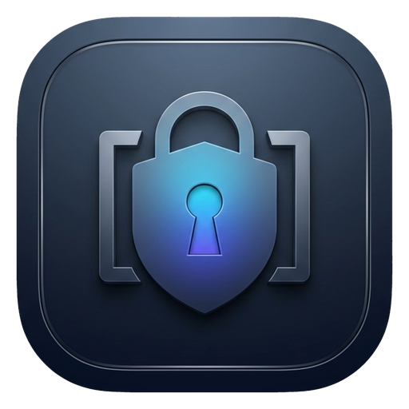

#  MD-Vault · 本地单文件 Markdown 加密账号管家

[](https://github.com/ataiben/md-vault/releases/latest)
[](https://github.com/ataiben/md-vault/actions/workflows/ci.yml)
[](LICENSE)
[](https://www.python.org/)
[](#快速开始)

**MD-Vault** 是一款**纯本地、零联网、单文件持久化**的桌面账号与密码管理工具（支持 **Windows** 与 **macOS**）。

它将日常分散在各处的网站、工作与个人邮箱、开发与云服务、办公及娱乐平台等账号密码归类整理，统一保存在**单个结构清晰、人类可读的 `.md`（Markdown）文件**中：平时既可以用优雅的三栏桌面客户端管理，也可以随时用 **Obsidian / VS Code / 记事本** 直接打开查阅与编辑。

---

## ✨ 核心特性

- **📄 单文件 `.md` 纯本地存储**：所有分类、标签与账号统一保存在单个 Markdown 文件中，无专有黑盒数据库格式，无云端服务器依赖，彻底杜绝格式锁定（Vendor Lock-in）。
- **🛡 字段级强加密（`AES-256-GCM`）**：分类、标题、用途标签、登录账号保持明文便于检索；**登录密码、密保答案、2FA 恢复码**采用 `PBKDF2-HMAC-SHA256 (600,000 次迭代) + AES-256-GCM` 自动加密为 `ENC[v1:...]`。
- **🔄 双向无损编辑 + 明文自动上锁**：支持直接用外部 Markdown 编辑器修改或手写新增账号；即使你在外部编辑器直接写了明文密码，下次在客户端解锁或点击同步时，系统也会**自动识别明文并将其加密回写落盘**。
- **☁️ 天然契合同步盘与笔记库**：支持一键挂载或切换电脑任意路径下的 `.md` 文件（例如直接存放在 **Obsidian 仓库、iCloud Drive、坚果云、OneDrive** 目录中实现多端同步）。
- **🗂 多账号高效归档设计**：内置分类目录、分类专属快捷标签沉淀、常用密保问答模板、账号一键克隆新建、强随机密码生成器、敏感剪贴板 **30 秒自动清空**。
- **⏪ 自动滚动快照防误删**：每次修改落盘采用原子替换（Atomic Write），并在同级 `.vault_backups/` 自动保留最近 5 份历史快照。
- **🌓 原生轻量桌面体验**：基于 `pywebview` 调用系统原生渲染引擎（Windows Edge WebView2 / macOS WebKit），支持深色与浅色主题切换。

---

## 🔍 存储格式预览（纯文本可读 + 核心凭据加密）

持久化后的 `.md` 文件可直接放入 Obsidian 或任意编辑器查看，结构干净清晰：

```markdown
---
vault_version: 1
vault_name: 我的账号密码库
kdf: pbkdf2-sha256
kdf_iterations: 600000
salt: 9xK2...
verifier: ENC[v1:...]
updated_at: '2026-11-11 15:30'
---

# 我的账号密码库

## 开发与云服务

### GitHub · 个人主力账号
<!-- id: acc_8f3a19c2 -->
- **收藏星标**: 是
- **服务/平台**: GitHub
- **分区/标签**: `主力`, `个人`, `开源`
- **登录账号**: `dev_demo@example.com`
- **登录密码**: `ENC[v1:r8Pq9L2...:k9Xm2vQ7...]`
- **辅助邮箱**: `backup_mail@example.com`
- **网址/入口**: https://github.com

#### 密保与恢复信息
- **密保问题 1**: 第一份工作所在的城市？ :: `ENC[v1:...]`
- **2FA / 恢复码**: `ENC[v1:...]`

#### 备注说明
已绑定硬件通行密钥（Passkey）与 TOTP 动态口令，每年定期轮换恢复码。
```

### 字段加密边界一览

| 字段类型 | 包含项 | 磁盘存储形式 |
| :--- | :--- | :--- |
| **明文检索层** | 分类、条目标题、服务平台、标签、登录账号、绑定手机、辅助邮箱、网址、备注说明 | **明文 Markdown**（支持在外部编辑器快速搜索） |
| **加密保护层** | **登录密码**、**密保问题答案**、**2FA 密钥 / 恢复码** | **`AES-256-GCM` 认证加密**（`ENC[v1:...]`） |

> ⚠️ **安全提示**：请勿将明文密码、助记词或私钥直接写入明文的「备注说明」栏，高敏恢复信息请填入受加密保护的「2FA 密钥 / 备用恢复码」栏。详见 [SECURITY.md](SECURITY.md)。

---

## 🚀 快速开始

### 方式一：下载免安装版（推荐普通用户）

无需安装 Python 环境，直接下载对应系统的编译成品压缩包：

- **Windows 10 / 11**：下载 [**`MD-Vault-Windows-x64.zip`**](https://github.com/ataiben/md-vault/releases/latest/download/MD-Vault-Windows-x64.zip)，解压后双击里面的 **`MD-Vault.exe`** 即可运行。
- **macOS (Apple Silicon)**：下载 [**`MD-Vault-macOS-arm64.zip`**](https://github.com/ataiben/md-vault/releases/latest/download/MD-Vault-macOS-arm64.zip)，解压后将 **`MD-Vault.app`** 拖入「应用程序」打开。
  > *macOS 首次打开提示*：由于开源构建未附加商业 Apple Developer 付费公证签名，首次打开若提示“无法验证开发者”，可在终端执行 `xattr -cr /Applications/MD-Vault.app` 或在「系统设置 → 隐私与安全性」中点击“仍要打开”。

---

### 方式二：从源码运行（面向开发者）

环境要求：**Python 3.9+**

#### 1. 克隆仓库并安装依赖

**Windows (PowerShell)：**
```powershell
git clone https://github.com/ataiben/md-vault.git
cd md-vault
python -m venv .venv
.\.venv\Scripts\pip install -r requirements.txt
```

**macOS (Terminal)：**
```bash
git clone https://github.com/ataiben/md-vault.git
cd md-vault
python3 -m venv .venv
./.venv/bin/pip install -r requirements.txt
```

#### 2. 启动应用

- **命令行通用启动**：
  ```bash
  python app.py
  ```
- **源码目录双击静默启动（需本地已装 Python 与依赖）**：
  - **Windows**：双击目录中的 `run_vault.vbs` 或 `启动账号管家.bat`（自动识别 `.venv` 虚拟环境）。
  - **macOS**：在 Finder 中双击 `run_macos.command`。

---

## ⌨️ 快捷键支持

| 功能 | Windows / Linux | macOS |
| :--- | :--- | :--- |
| 聚焦全局搜索框 | `Ctrl + F` | `⌘ + F` |
| 新建账号记录 | `Ctrl + N` | `⌘ + N` |
| 编辑状态下保存账号 | `Ctrl + S` | `⌘ + S` |
| 立即锁定密码库 | `Ctrl + L` | `⌘ + L` |
| 关闭弹窗 | `Esc` | `Esc` |

---

## 📦 自行打包独立可执行文件

项目内置跨平台 PyInstaller 打包脚本 `build_app.py`：

```bash
pip install -r requirements-dev.txt
python build_app.py
```

构建产物输出在 `dist/` 目录下：
- **Windows**：生成单文件便携版 `dist/MD-Vault.exe`
- **macOS**：生成原生应用包 `dist/MD-Vault.app`

---

## 🧪 运行单元测试

```bash
pip install -r requirements-dev.txt
pytest
```

---

## 📄 开源协议与免责声明

本项目基于 [MIT License](LICENSE) 开源。

- 请牢记您的**主密码**——MD-Vault 无任何云端账号体系与后门，一旦遗忘主密码将无法解密 `ENC[v1:...]` 敏感字段（但您仍可直接打开 `.md` 查看明文账号与备注）。
- 建议将 `.md` 密码库保存在个人同步盘（如 iCloud / OneDrive / 坚果云）并定期备份，**切勿将个人真实密码库提交至公开的 Git 仓库**。
